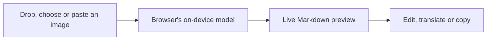

# XCan

Extract the text from any image (screenshot, scan, photo, handwriting), right in your browser. The layout comes out as Markdown you can edit, translate and copy.

XCan reads the image with the AI model built into **Google Chrome** or **Microsoft Edge**, through the browser's [Prompt API](https://webmachinelearning.github.io/prompt-api/) (`LanguageModel`). There is no server, no account and no API key. Your images never leave your device.



## Quick start

1. Open XCan in **Chrome 148 or later** on a desktop computer (or Edge Canary/Dev with the Prompt API flag).
2. If asked, click **Download model**. The browser downloads it once and shares it with every site.
3. Drop an image. The Markdown appears as the model writes it.

> [!IMPORTANT]
> Desktop only, and the model needs about 22 GB of free disk space plus a capable GPU or 16 GB of RAM. See [Browser setup](docs/browser-setup.md).

## Features

- Drop, choose or paste (`Ctrl+V`) any image up to 10 MB.
- Live streaming preview with fade-in, plus an editable Markdown tab with undo.
- Keeps visible formatting: headings, emphasis, lists, task lists, tables, code, quotes, links.
- Translate the result into another language (source language detected), on device.
- Copy the Markdown to the clipboard.
- Light and dark themes; minimal, icon-based, monochrome UI.
- Private by design: no upload, no backend.

## Documentation

| Page | For | Contents |
|---|---|---|
| [User guide](docs/user-guide.md) | Users | First visit, converting an image, result pane, privacy, limitations |
| [Browser setup](docs/browser-setup.md) | Users | Chrome and Edge requirements, setup steps, what the device checklist means |
| [Architecture](docs/architecture.md) | Developers | Provider interface, session lifecycle, one conversion, structured output, rendering safety, file layout |
| [Development](docs/development.md) | Developers | Run locally, deploy to GitHub Pages, testing, guidelines, history |

## Run locally

```bash
python -m http.server 8000 --directory src
```

Then open <http://localhost:8000/>. No build step, no npm. Deploying to GitHub Pages: see [Development](docs/development.md#deploy-to-github-pages).
