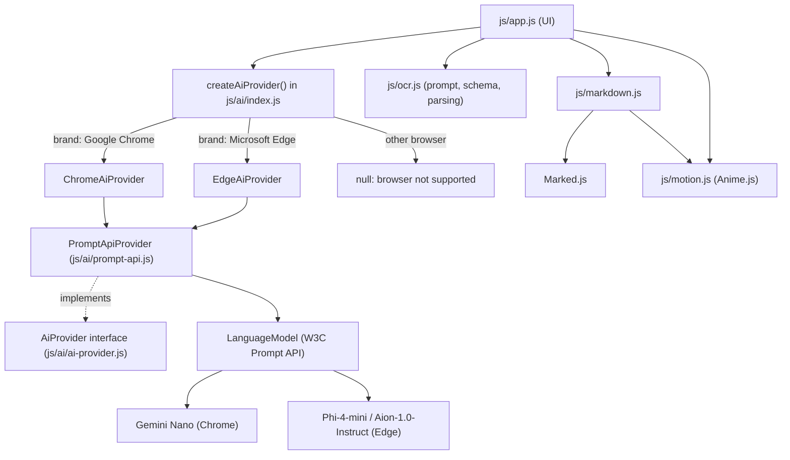
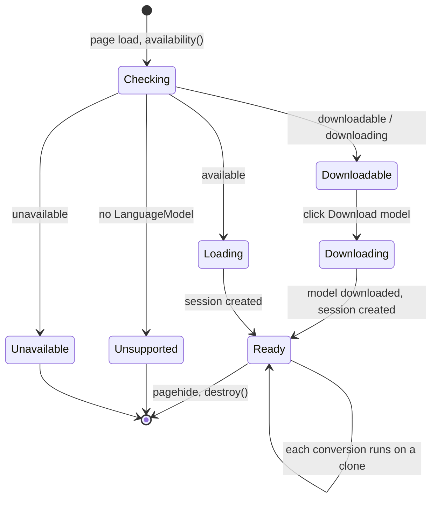
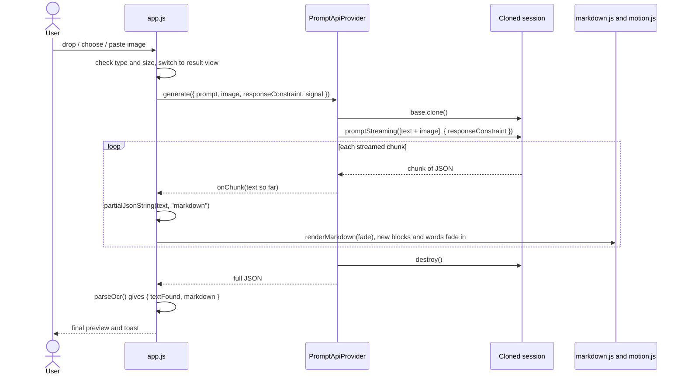

# Architecture

How XCan is built: a static page that talks to the browser's on-device model through one interface.

[← Back to README](../README.md)

## Overview



## File layout

The deployed site is everything in `src/`. Diagram labels below are relative to it.

| Path | Role |
|---|---|
| [src/index.html](../src/index.html) | Page markup, SEO metadata, CDN links |
| [src/css/app.css](../src/css/app.css) | Theme tokens (light/dark, monochrome) and component styles on top of Bootstrap |
| [src/js/app.js](../src/js/app.js) | UI logic: boot flow, help dialog, input, generation, output actions, theme |
| [src/js/ocr.js](../src/js/ocr.js) | System prompt, JSON schema, parsing of the streamed reply |
| [src/js/markdown.js](../src/js/markdown.js) | Marked.js sanitizer and `renderMarkdown()` |
| [src/js/motion.js](../src/js/motion.js) | All animations (Anime.js), reduced-motion aware |
| [src/js/ai/ai-provider.js](../src/js/ai/ai-provider.js) | `AiProvider` interface |
| [src/js/ai/prompt-api.js](../src/js/ai/prompt-api.js) | `PromptApiProvider`: shared `LanguageModel` code (session lifecycle, streaming, errors, device checks) |
| [src/js/ai/chrome-provider.js](../src/js/ai/chrome-provider.js) | `ChromeAiProvider`: name, docs, setup help, CPU/RAM checks |
| [src/js/ai/edge-provider.js](../src/js/ai/edge-provider.js) | `EdgeAiProvider`: name, docs, setup help |
| [src/js/ai/index.js](../src/js/ai/index.js) | `createAiProvider()` picks the provider for the current browser |
| [src/assets/favicon.svg](../src/assets/favicon.svg) | Favicon (Material Symbols `document_scanner`) |
| [src/sitemap.xml](../src/sitemap.xml) | Sitemap for search engines |
| [.github/workflows/pages.yml](../.github/workflows/pages.yml) | Deploys `src/` to GitHub Pages on push to `master` |

Stack: semantic HTML, plain JavaScript (ES modules), Bootstrap 5.3.3, Material Symbols Rounded, Marked.js 15.0.12, Anime.js 4.4.1, all from CDNs. No build step, no npm.

## AI provider interface

`js/app.js` never calls `LanguageModel` directly. It talks to `AiProvider`:

| Member | Purpose |
|---|---|
| `name` | "Google Chrome" / "Microsoft Edge" |
| `isSupported()` | `LanguageModel` exists |
| `isReady` | Session created and alive |
| `availability()` | `'available' \| 'downloadable' \| 'downloading' \| 'unavailable'` |
| `init(system, onProgress?)` | Loads the model (downloads it if needed) and creates the long-lived session with the system prompt |
| `generate({ prompt, image, signal, onChunk, responseConstraint })` | One conversion; streams the reply |
| `destroy()` | Releases the session |
| `docs` | Links to the browser's official docs |
| `setupHelp(availability)` | `{ title, md }`: Markdown help shown in the dialog |
| `checks(availability)` | `[met, label][]`: what the page can test about the device (`met` is `null` when it cannot tell) |
| `describeError(error)` | User-facing error text |

Browser detection uses `navigator.userAgentData.brands`: `Microsoft Edge` → Edge provider, `Google Chrome` → Chrome provider, anything else → none.

`PromptApiProvider` holds everything the two browsers share. The Chrome and Edge subclasses add only their name, docs links, setup help and device checks. Both request `expectedInputs: text (en) + image` and `expectedOutputs: text (en)`, with the same options for `availability()` and `create()`.

## Model session lifecycle



- One long-lived base session is created with the system prompt as soon as the model is available (about 14 s to load in testing).
- The download must start from a click, because the API requires a user gesture. `downloadprogress` events drive the progress bar; at 100% it turns indeterminate while the browser extracts and loads the model, as the [Chrome guide](https://developer.chrome.com/docs/ai/inform-users-of-model-download) recommends.
- Each conversion runs on `clone()` of the base session, so runs never see each other's images. The clone is destroyed when the run ends.
- The base session is destroyed on `pagehide`.

## One conversion



**Stop** aborts the run through an `AbortSignal` and keeps whatever has streamed so far.

## Structured output

Every prompt passes a JSON Schema as `responseConstraint`, so the model can only reply in this shape:

```json
{ "textFound": true, "markdown": "..." }
```

- Preambles, notes, image descriptions and wrapping code fences cannot leak into the result.
- `textFound` comes first, so the model decides it before writing. `false` leaves the result empty and shows "No text found in this image".
- Streaming still works: `partialJsonString()` reads the `markdown` string out of the unfinished JSON on every chunk.

Earlier findings that shaped this: without structured output the model added text that is not in the image (for example a "Screenshot of handwritten text" heading), and a prompt with an easy "no text" escape made it skip handwriting entirely.

## System prompt

Compressed for a small model; rule order matters. It says: transcribe all text first, including handwriting and odd words (best guess); keep the original language; only text written in the image (no title, caption or description); map visible formatting to Markdown (headings, emphasis, lists, task lists, pipe tables, `~~~` code fences, quotes, links, separators, `*[Image: …]*` for pictures, inline code for math); no HTML. See [src/js/ocr.js](../src/js/ocr.js).

## Rendering safety

Model output is untrusted. [src/js/markdown.js](../src/js/markdown.js) configures Marked so that:

- raw HTML is escaped and shown as text;
- `javascript:`, `vbscript:` and `data:` links and images become `#`;
- links open in a new tab with `noopener noreferrer`.

The help dialog uses the same renderer for its Markdown text.

Live fading: `motion.morph()` compares the new render with the current DOM. Unchanged blocks stay, new blocks fade in, and new words in the block being written fade in. Manual edits re-render without animation.
