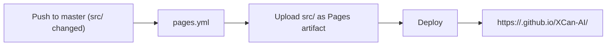

# Development

Run, deploy, test and contribute.

[← Back to README](../README.md)

## Run locally

No build step and no npm. The site is the `src/` folder. Serve it over HTTP; ES modules do not load from `file://`.

```bash
python -m http.server 8000 --directory src
```

Open <http://localhost:8000/> in Chrome or Edge. `localhost` counts as a secure context, which the Prompt API requires.

## Deploy to GitHub Pages

The site is deployed by the workflow [.github/workflows/pages.yml](../.github/workflows/pages.yml), based on GitHub's [static starter workflow](https://github.com/actions/starter-workflows/blob/main/pages/static.yml). It uploads only `src/`, so docs and tooling files are not published. Branch publishing can only serve `/` or `/docs`, which is why a workflow is used.



One-time setup:

1. In the repository, open **Settings → Pages**.
2. Under **Build and deployment**, set **Source** to **GitHub Actions**.
3. Push a change under `src/` to `master`, or run the workflow from the **Actions** tab (**Run workflow**).
4. When the run finishes, its summary shows the site URL.

The app uses relative paths only, so it works under the `/XCan-AI/` sub-path. Pages serves over HTTPS, which gives the secure context the Prompt API needs.

> [!NOTE]
> On a free account the repository must be public to use Pages. If the site URL changes (renamed repo, custom domain), update the canonical link, `og:url` and JSON-LD `url` in `src/index.html`, and the URL in `src/sitemap.xml`.

Any other static host works the same way, as long as it serves over HTTPS.

## Testing

There is no automated test suite. Check changes in a real browser:

- Serve the site and open it in Chrome with the on-device model available.
- To mimic the GitHub Pages sub-path, serve the repository root (`python -m http.server 8000`) and open `http://localhost:8000/src/`.
- Check desktop and phone widths (for example 1366 px and 390 px).
- Without a real model, a fake `LanguageModel` injected before page scripts (for example with Playwright's `addInitScript`) can return any `availability()` result and stream any reply. This covers the download, unavailable and streaming paths.

<details>
<summary>Last manual run (2026-11-16, Chrome 157 via Playwright)</summary>

Temp profile with a copy of the local Gemini Nano model, site served under `/XCan-AI/` like GitHub Pages.

| Check | Result |
|---|---|
| Provider detection | Chrome → `ChromeAiProvider` |
| Session created on load | Ready after about 14 s |
| OCR of a handwriting sample | About 29 s, transcribed text only, no invented title |
| Structured output | Valid `{ textFound, markdown }`, streamed live |
| Loading effects | Scan line, timer chip, skeleton shown |
| Markdown rendering | Tables, task lists, quotes, code render |
| Sanitization | `` escaped, `javascript:` link → `#`, no script ran |
| Edit / undo, theme toggle | Work |
| Download progress (fake model) | Percentage shown, striped bar at 100%, then the app opens |
| Device checklist (fake model) | Missing image input reported |

Edge 157: the download dialog renders and `availability()` returns `downloadable` with image input. Loading the model after **Download model** failed once with "The model could not be loaded"; the cause is not known yet.

</details>

## Guidelines

- Keep it static: no build step, no npm, no backend. Libraries come from CDNs with pinned versions. Paths stay relative.
- Keep `app.js` behind the `AiProvider` interface. Browser-specific wording and checks go in the Chrome or Edge provider; shared Prompt API code goes in `prompt-api.js`.
- Facts shown to users (versions, hardware, flags, errors) must come from the official browser docs listed in [Browser setup](browser-setup.md).
- UI stays minimal and icon-based: every icon control gets a tooltip and an `aria-label`. Colors stay monochrome. Animations go through `src/js/motion.js` and respect `prefers-reduced-motion`.
- Help and setup text is Markdown, rendered by Marked in the Bootstrap modal.
- When behavior changes, update the matching page in `docs/` and the history below.