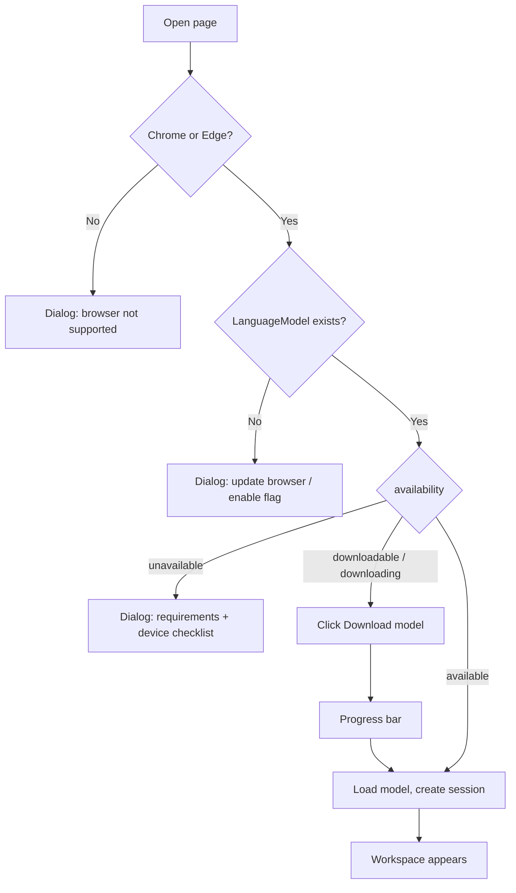
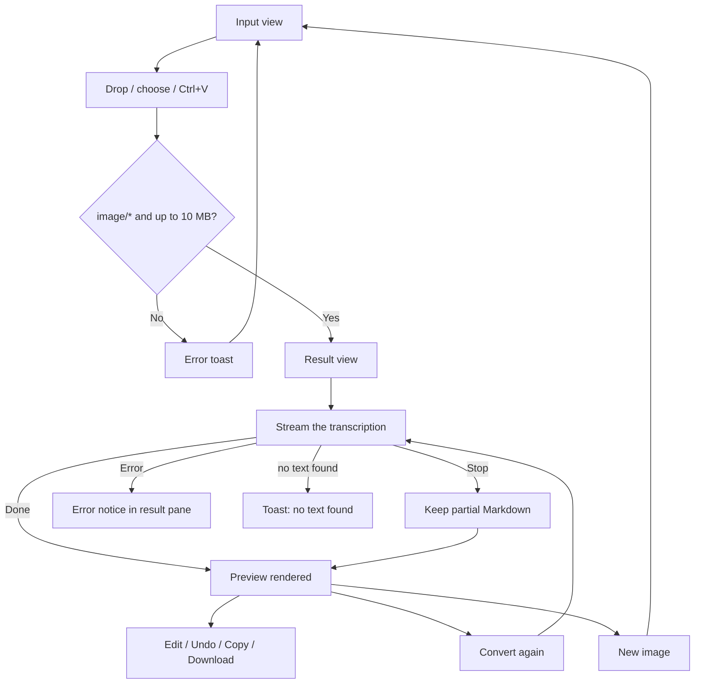

# User guide

What XCan does and how to use it.

[← Back to README](../README.md)

## First visit

- A boot screen ("Preparing XCan") covers the app until the model session is ready. Nothing can be dropped or pasted before that.
- When you must act or cannot continue, a dialog explains why, lists the requirements from the official docs and links to them. Closing it leaves a short title and a button to reopen it on the boot screen.
- **Download model** starts the download (the browser requires a click for it). The bar shows the percentage. At 100% the browser still extracts and loads the model, so the bar turns striped until the app opens.

See [Browser setup](browser-setup.md) for requirements.

## Convert an image

- The app shows one view at a time.
  - **Input view**: only the drop area. Drop an image, click to choose one, or paste with `Ctrl+V`.
  - **Result view**: only the live preview, with a thumbnail of the image in its header.
- Any `image/*` type up to 10 MB (the picker suggests PNG, JPG, WEBP, GIF).
- Conversion starts on its own. The preview fills in as the model writes: new blocks and new words fade in.
- Pasting another image in the result view replaces it and converts again.

## Result pane

| Control | What it does |
|---|---|
| **Preview** tab | Markdown rendered with GFM: headings, emphasis, lists, task lists, tables, code, quotes, links |
| **Edit Markdown** tab | Editable source; the preview updates as you type |
| Stop | Ends the run and keeps what has streamed so far (shown while running) |
| Convert again | Runs the same image again |
| Undo my edits | Restores the model's output (shown after you edit) |
| Copy Markdown | Copies the source to the clipboard |
| Download .md | Saves `xcan-output.md` |
| New image | Back to the input view |

While running, a scan line sweeps the thumbnail, a timer counts seconds, and skeleton lines show until the first words arrive.

What the model keeps: headings, bold/italic/strikethrough, lists, checkboxes, pipe tables, code blocks, quotes, links, separators. Pictures become `*[Image: short description]*`. It transcribes only text written in the image, in its original language, and never adds a title or caption.

## Header

- **XCan** wordmark; its tooltip explains the app.
- **Status dot**: pulsing = checking or loading, solid = ready, light grey = action needed or blocked. The tooltip gives the detail, such as "Downloading model 42%".
- GitHub link.
- Theme toggle: light or dark. Follows the OS until you choose; the choice is saved in `localStorage` (`xcan-theme`).

## Look and feel

- Minimal, icon-based UI. Every icon has a tooltip and an `aria-label`.
- Monochrome: black, white and greys only, in light and dark themes.
- Motion uses Anime.js and respects `prefers-reduced-motion` (effects become instant or static).

## Privacy

- The image is processed by the model inside your browser. It is never uploaded.
- The app has no backend and makes no API calls. The only network requests are the page itself, its libraries from the jsDelivr CDN (Bootstrap, Marked, Anime.js) and Google Fonts (Material Symbols), plus the one-time model download done by the browser.
- The only thing stored is your theme choice.

## Known limitations

- Edge image input is not confirmed by Microsoft's docs; Edge may only show the setup help.
- Small on-device models can misread messy handwriting and complex layouts. Results may need edits.
- The session declares English output. Other languages are still transcribed, but quality is not guaranteed.
- Only the errors the official Chrome docs name (`QuotaExceededError`, `NotSupportedError`) get a friendly message; others show the browser's own message.
- No mobile support.
