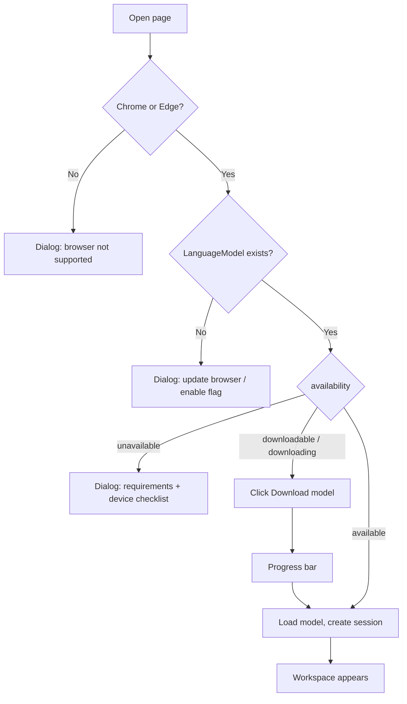
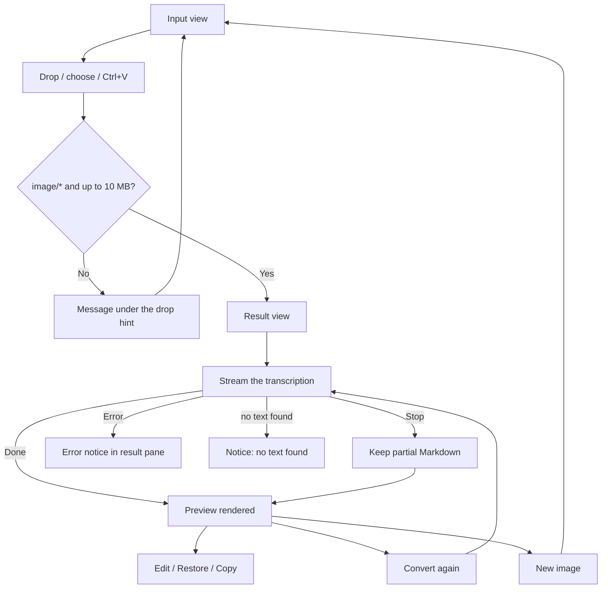
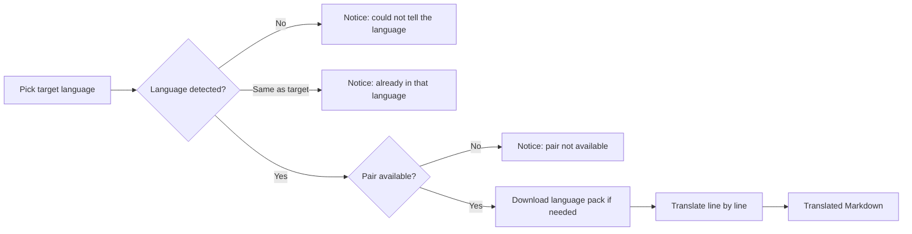

# User guide

What XCan does and how to use it.

[← Back to README](../README.md)

## First visit

- The page is a short landing page: a headline with five icon highlights, the tool right under it, then three icon steps (Add, Scan, Copy). Details are in tooltips; the footer links the Chrome and Edge docs. Blocks fade up once as they scroll into view.
- In the tool area, a boot screen ("Preparing XCan") shows until the model session is ready. Nothing can be dropped or pasted before that. Adding an image scrolls the tool into view.
- When you must act or cannot continue, a dialog explains why, lists the requirements from the official docs and links to them. Closing it leaves a short title and a button to reopen it on the boot screen.
- **Download model** starts the download (the browser requires a click for it). The bar shows the percentage. At 100% the browser still extracts and loads the model, so the bar turns striped until the app opens.

See [Browser setup](browser-setup.md) for requirements.

## Convert an image

- The app shows one view at a time.
  - **Input view**: only the drop area. Drop an image, click to choose one, or paste with `Ctrl+V`.
  - **Result view**: only the live preview, with a thumbnail of the image in its header. Click the thumbnail to see the original image in a dialog.
- Any `image/*` type up to 10 MB (the picker suggests PNG, JPG, WEBP, GIF).
- Conversion starts on its own. The preview fills in as the model writes: new blocks and new words fade in.
- Pasting another image in the result view replaces it and converts again.

## Result pane

| Control | What it does |
|---|---|
| **Preview** tab | Markdown rendered with GFM: headings, emphasis, lists, task lists, tables, code, quotes, links |
| **Edit Markdown** tab | Editable source; the preview updates as you type |
| Stop | Ends the run and keeps what has streamed so far (shown while running) |
| Convert again | Runs the same image again |
| Translate | Pick a target language; the source language is detected. See [Translate](#translate) |
| Restore original | Brings back the model's output after an edit or a translation |
| Copy Markdown | Copies the source to the clipboard |
| New image | Back to the input view |

While the model reads the image, the preview shows a ring loader until the first words arrive.

What the model keeps: headings, bold/italic/strikethrough, lists, checkboxes, pipe tables, code blocks, quotes, links, separators. Pictures become `*[Image: short description]*`. It transcribes only text written in the image, in its original language, and never adds a title or caption.

## Translate

Click the translate icon and pick a language. XCan detects the language of the text, then translates the Markdown into the one you picked. The text keeps scrambling while it works, then the translation scrambles into place.

- Formatting is kept: headings, list and checkbox markers, quotes and table pipes stay; code blocks are not translated.
- The first time a language pair is used, the browser downloads its language pack, so that translation takes longer.
- The translation shows only in the Preview. The Edit Markdown tab (and Copy) keep the original Markdown, so picking another language always translates the original, and picking the original language shows it again. Editing the Markdown drops the translation.
- **Stop** cancels and leaves the text unchanged. **Restore original** brings back the transcription.
- The menu appears only in browsers with the Translator and Language Detector APIs.
- Translation runs on the device, like the OCR.

## Header

- **XCan** wordmark; its tooltip explains the app.
- GitHub link.
- Theme toggle: light or dark. Follows the OS until you choose; the choice is saved in `localStorage` (`xcan-theme`).

## Look and feel

- Minimal, icon-based UI. Every icon has a tooltip and an `aria-label`.
- Monochrome: black, white and greys, in light and dark themes.
- Motion is kept to three effects (Anime.js): the result fades in, the live preview fades in new words, and a translation scrambles into place. With `prefers-reduced-motion` they are skipped.

## Privacy

- The image is processed by the model inside your browser. It is never uploaded.
- The app has no backend and makes no API calls. The only network requests are the page itself, its libraries from the jsDelivr CDN (Bootstrap, Marked, Anime.js) and Google Fonts (Roboto, Roboto Mono, Material Symbols), plus the one-time model download done by the browser.
- The only thing stored is your theme choice.

## Known limitations

- Edge image input is not confirmed by Microsoft's docs; Edge may only show the setup help.
- Small on-device models can misread messy handwriting and complex layouts. Results may need edits.
- The session declares English output. Other languages are still transcribed, but quality is not guaranteed.
- Only the errors the official Chrome docs name (`QuotaExceededError`, `NotSupportedError`) get a friendly message; others show the browser's own message.
- No mobile support.
- Translation sends plain text line by line, so inline formatting (bold, links) inside a line may not survive every translation. Very short texts may not be detected reliably.
